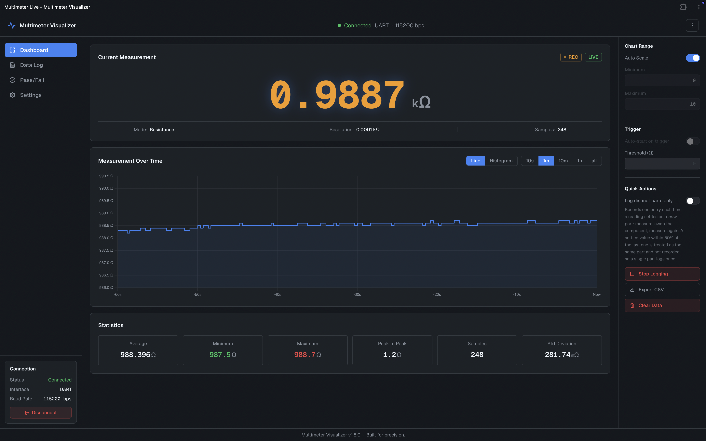

# Multimeter·Live

**Your ZOYI ZT703s, live in the browser.** Watch readings as they happen, see trends and
noise at a glance, log a week of data, and sort parts pass/fail by ear. No install, no
account, no backend. Your data never leaves your machine.

[](https://github.com/Fyfar/multimeter-live/actions/workflows/deploy.yml)
[](https://github.com/Fyfar/multimeter-live/blob/main/package.json)
[](./LICENSE)




### **[Open the app →](https://fyfar.github.io/multimeter-live/)**

## Features

- **Live readout and trend chart**, from a 10-second window to the whole session.
- **Histogram** binned to the meter's own resolution: noise, drift and how tightly a batch
  of parts clusters, at a glance.
- **Log for up to 7 days** with running average, min, max, peak-to-peak and standard
  deviation. Searchable log with notes, **CSV export**.
- **Pass/Fail sorting.** Set a reference and tolerance, touch parts one after another, and
  hear the verdict: pass and fail tones are distinct enough to sort a tray of resistors
  without looking at the screen. Verdicts export to their own CSV.
- **Smart capture.** Record only stable values, or let a trigger threshold start and stop
  recording for you.
- **USB or Bluetooth.** Use a USB-UART adapter, or go wireless with a BLE serial module
  wired to the meter. Your USB adapter reconnects on its own when you come back.
- **Desktop, tablet and phone.** The layout adapts to the screen.
- **Installable and offline.** Install it like a native app; after the first visit it
  needs no network. Updates never interrupt a recording.
- **Light and dark themes.**

## What you need

**Meter:** a **ZOYI ZT703s** (tested on firmware 1.6.27). The ZT703s+ and ZT706 likely
speak the same protocol but are untested. For Bluetooth, a BLE serial module set to
**115200 baud**: tested with a **JDY-23**; HM-10 and its clones will probably work.

**Browser:**

| | USB | Bluetooth |
|---|:---:|:---:|
| Chrome, Edge, Opera (desktop) | ✓ | ✓ |
| Firefox 151+ (desktop) | ✓ | – |
| Chrome and other Chromium browsers on Android | – | ✓ (untested) |
| Safari, and any browser on iPhone or iPad | – | – |

On iPhone and iPad the app opens but cannot connect: Apple makes every iOS browser use
Safari's engine, which supports neither Web Serial nor Web Bluetooth. The page must be
served over `https://` or `localhost`; the hosted app already is.

## Good to know

- **Recorded data lives in the open tab.** A reload brings back the connection, not the
  data, so export a CSV before you close it.
- **AC vs DC and frequency are not sent by the meter** over its serial output, so readings
  show as plain "Voltage" and "Current". Check AC/DC on the meter itself.
- **Pass/Fail covers resistance, diode and capacitance.** A dead short reads as "no part",
  so it catches out-of-tolerance parts, not shorts.
- **On a phone, a locked screen or background tab will likely drop Bluetooth.** Great for
  quick checks, not for week-long logging.

> **Not an official ZOYI / ZOTEK product.** Multimeter·Live is an independent,
> community-built project and is **not affiliated with, endorsed by, or supported by ZOYI
> or ZOTEK**. "ZOYI", "ZOTEK", and "ZT703s" are referenced only to describe the hardware
> this tool works with.

## Run it locally

```sh
npm install
npm run dev
```

Then open [http://localhost:3000](http://localhost:3000).

## Contributing

Issues and pull requests are welcome, especially if you can confirm whether a ZT703s+,
ZT706 or an Android phone works. Open an [issue](https://github.com/Fyfar/multimeter-live/issues)
or send a PR.

## License

[MIT](./LICENSE)
